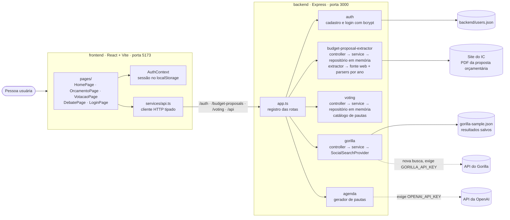

# Ágora

Uma plataforma para visualizar e compreender dados orçamentários, acompanhar a distribuição de recursos e participar de decisões coletivas sobre como esses recursos podem ser utilizados.

Membros:

- Lucas Mantovani Boaro - 281303
- Gabriel Saia Schade - 281202
- Bruno Amaral Salles de Moraes - 281129
- Fernando de Almeida Maciel Penido - 281180
- Mateus Pachela Garcia - 259554

Projeto da Disciplina MC656 - Engenharia de Software, orientado pelo Professor Bruno Cafeo

## Escopo do MVP

Esta versão cobre o **Instituto de Computação (IC) da Unicamp**:

- **Orçamento (`/orcamento`):** a previsão orçamentária de 2020 do IC, extraída automaticamente do PDF publicado no site do instituto, com totais, gráfico por seção, explicações dos termos e busca por item.
- **Votação (`/votacao`):** pautas inspiradas em itens do orçamento, com voto único por pessoa e apuração. A consulta é consultiva.
- **Opinião pública (`/debate`):** manifestações públicas em redes sociais coletadas pelo Gorilla, com filtros por palavra-chave e fonte.
- **Início (`/`) e conta (`/login`):** apresentação do projeto, papel dos órgãos colegiados do IC e cadastro/login.

Outros contextos e a geração automática de pautas ficam para versões futuras, aproveitando a separação em módulos do backend.

## Arquitetura

O projeto é um monorepo com dois workspaces npm. O frontend chama o backend por HTTP. Em desenvolvimento, o Vite encaminha as rotas da API para a porta 3000.



### Módulos do backend (`backend/src/modules`)

| Módulo                      | Responsabilidade                                                                                                                                                                                                                                                                                                   |
| --------------------------- | ------------------------------------------------------------------------------------------------------------------------------------------------------------------------------------------------------------------------------------------------------------------------------------------------------------------ |
| `auth`                      | Cadastro com validação e login. As senhas são guardadas com hash bcrypt em `users.json`, e o login tem limite de 5 tentativas a cada 15 minutos.                                                                                                                                                                   |
| `budget-proposal-extractor` | Encontra o PDF da proposta orçamentária na página de documentos do IC, extrai o texto e converte em itens com seção, subseção, valores, fonte e prioridade. O parser de cada exercício é escolhido por **Strategy**. A extração fica em cache em memória, e requisições simultâneas reaproveitam a mesma extração. |
| `voting`                    | Catálogo de pautas, registro de um voto por participante em cada pauta e apuração. Os dados ficam em memória.                                                                                                                                                                                                      |
| `gorilla`                   | Lê os resultados salvos de uma busca em redes sociais e dispara novas buscas. O fornecedor fica atrás da interface `SocialSearchProvider`, implementada pelo **Adapter** `GorillaSearchAdapter`.                                                                                                                   |
| `agenda`                    | Gera um título e itens de pauta a partir de um contexto, usando a OpenAI. É opcional e não é usado pelas telas do MVP.                                                                                                                                                                                             |

### Telas do frontend (`frontend/src`)

| Rota         | Arquivo                   | Backend usado                                 |
| ------------ | ------------------------- | --------------------------------------------- |
| `/`          | `pages/HomePage.tsx`      | Nenhum                                        |
| `/orcamento` | `pages/OrcamentoPage.tsx` | `GET /budget-proposals/ic/2020`               |
| `/votacao`   | `pages/VotacaoPage.tsx`   | `GET /voting/proposals`, `POST .../votes`     |
| `/debate`    | `pages/DebatePage.tsx`    | `GET /api/gorilla`, `POST /api/gorilla/fetch` |
| `/login`     | `pages/LoginPage.tsx`     | `POST /auth/register`, `POST /auth/login`     |

## Como executar

### Pré-requisitos

- Node.js 24 (versão definida em `.nvmrc`; com nvm, rode `nvm use`) e npm.
- Acesso à internet para a primeira consulta ao orçamento, que baixa o PDF do site do IC.

### 1. Instalar as dependências

Na raiz do repositório:

```bash
npm ci
```

### 2. Configurar o ambiente do backend

```bash
cp backend/.env.example backend/.env
```

| Variável          | Obrigatória | Uso                                                                                    |
| ----------------- | ----------- | -------------------------------------------------------------------------------------- |
| `PORT`            | Não         | Porta do backend. O padrão é `3000`, que é a porta usada pelo proxy do frontend.       |
| `GORILLA_API_KEY` | Não         | Só para disparar novas buscas no Gorilla. Sem ela, `/debate` usa os resultados salvos. |
| `OPENAI_API_KEY`  | Não         | Só para o gerador de pautas (`POST /api/agenda`).                                      |

As chaves não devem ser versionadas. O arquivo `backend/.env` já está no `.gitignore`.

### 3. Iniciar backend e frontend

```bash
npm run dev
```

- Frontend: http://localhost:5173
- Backend: http://localhost:3000

Para iniciar cada parte separadamente:

```bash
npm run dev --workspace backend
```

```bash
npm run dev --workspace frontend
```

### 4. Roteiro rápido de uso

1. Abra http://localhost:5173 e crie uma conta em **Entrar › Cadastrar**. Depois, faça login.
2. Em **Orçamento**, aguarde a primeira extração (alguns segundos) e explore o gráfico, as explicações e a busca de itens.
3. Em **Votação**, escolha Sim ou Não em uma pauta, confirme e veja a apuração.
4. Em **Debate**, filtre as publicações por palavra-chave ou fonte.

Os dados de votação e o cache do orçamento ficam em memória e são perdidos ao reiniciar o backend. As contas ficam em `backend/users.json`, que não é versionado.

## Testes e qualidade

| Comando                                      | O que faz                                                                      |
| -------------------------------------------- | ------------------------------------------------------------------------------ |
| `npm test`                                   | Testes do backend e do frontend (Vitest).                                      |
| `npm run test:coverage`                      | Testes com relatório de cobertura em `backend/coverage` e `frontend/coverage`. |
| `npm run test:mutation --workspace backend`  | Teste de mutação com Stryker no parser da proposta orçamentária.               |
| `npm run test:mutation --workspace frontend` | Teste de mutação com Stryker nos módulos configurados do frontend.             |
| `npm run lint`                               | Análise estática com ESLint.                                                   |
| `npm run format:check`                       | Verifica a formatação com Prettier (`npm run format` corrige).                 |
| `npm run build`                              | Compila o backend (TypeScript) e gera o build do frontend.                     |

O workflow de CI (`.github/workflows/ci.yml`) roda em todo PR e push para `develop` e `main`. Ele verifica formatação, lint, build e testes com cobertura, e envia a análise ao SonarQube Cloud.

## API do backend

| Método | Rota                                    | Descrição                                                                                                  |
| ------ | --------------------------------------- | ---------------------------------------------------------------------------------------------------------- |
| `POST` | `/auth/register`                        | Cadastra um usuário. `201` criado, `400` dados inválidos, `409` nome ou e-mail já usado.                   |
| `POST` | `/auth/login`                           | Autentica por nome ou e-mail e senha. `200` sucesso, `401` credenciais inválidas, `429` limite.            |
| `GET`  | `/budget-proposals/ic/:year`            | Proposta orçamentária do IC. `200`, `400` ano inválido, `404` ano sem parser (hoje só 2020).               |
| `GET`  | `/voting/proposals?voterId=`            | Pautas com apuração e, se `voterId` for informado, o voto dessa pessoa em cada pauta.                      |
| `POST` | `/voting/proposals/:proposalId/votes`   | Registra `{ "voterId", "option": "sim" \| "nao" }`. `201`, `400`, `404` pauta inexistente, `409` já votou. |
| `GET`  | `/voting/proposals/:proposalId/results` | Apuração da pauta. `200` ou `404`.                                                                         |
| `GET`  | `/api/gorilla`                          | Resultados salvos da última busca em redes sociais.                                                        |
| `POST` | `/api/gorilla/fetch`                    | Nova busca no Gorilla (`query` na URL ou no corpo). Salva e retorna o resultado. Exige chave.              |
| `POST` | `/api/agenda`                           | Gera uma pauta a partir de `{ "context" }`. `503` sem `OPENAI_API_KEY`.                                    |

Exemplos:

```bash
curl http://localhost:3000/budget-proposals/ic/2020
```

```bash
curl -X POST http://localhost:3000/voting/proposals/wifi-ic1-ic2/votes \
  -H "Content-Type: application/json" \
  -d '{"voterId": "ana@unicamp.br", "option": "sim"}'
```

```bash
curl -X POST "http://localhost:3000/api/gorilla/fetch?query=Unicamp"
```

Para inspecionar a extração do PDF sem subir o servidor:

```bash
npm run inspect:budget-pdf --workspace backend
```

## Fluxo de desenvolvimento

- `main` guarda as versões entregues, marcadas com tags (`a4-v1.0.0`, `a5-v1.0.0`, ...).
- `develop` integra o trabalho em andamento.
- Cada mudança é feita em uma branch própria a partir de `develop` (`feat/...`, `fix/...`, `test/...`, `docs/...`), vinculada a uma issue e integrada por pull request revisado por outro integrante, com o CI aprovado.
- Para uma entrega, uma branch `release/...` leva `develop` para `main`, a tag é criada no commit de merge e `main` é sincronizada de volta em `develop`.
